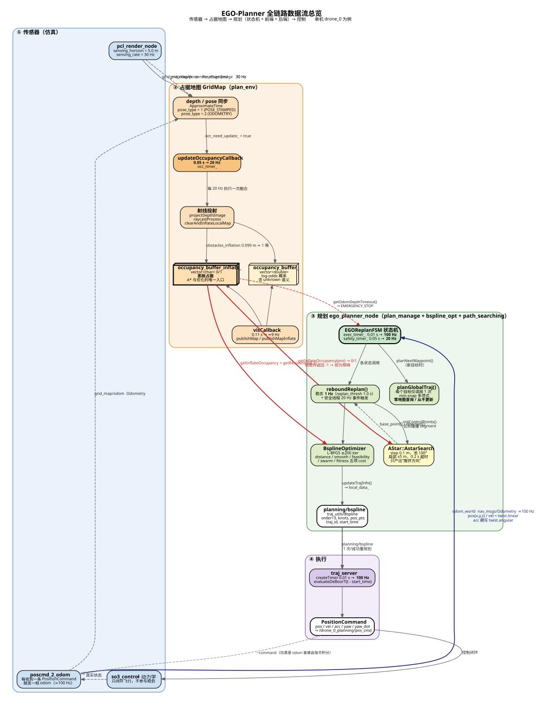
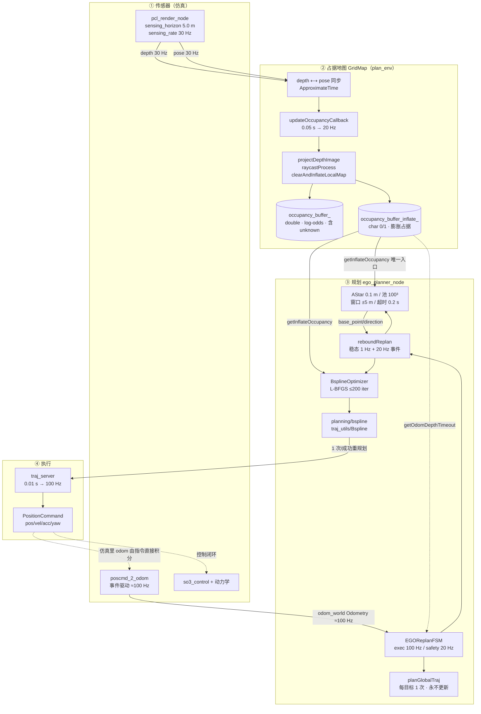
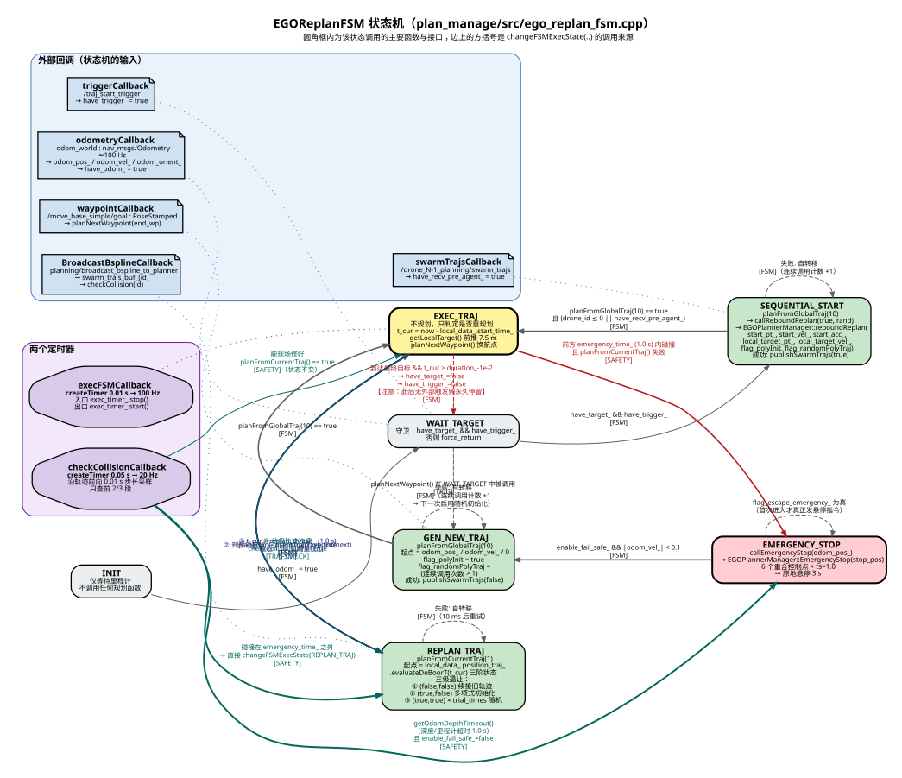
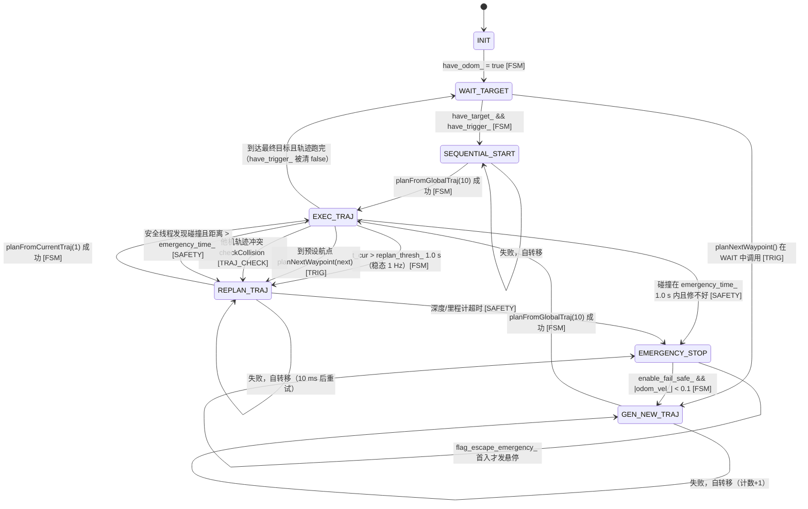
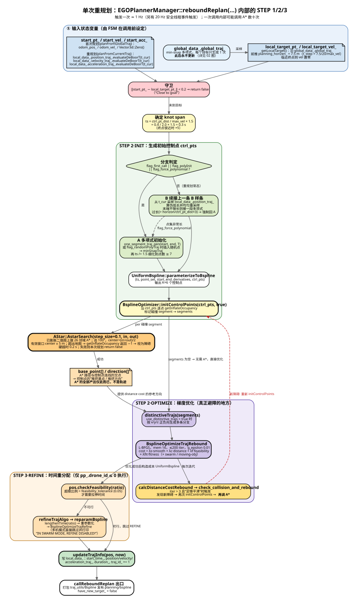
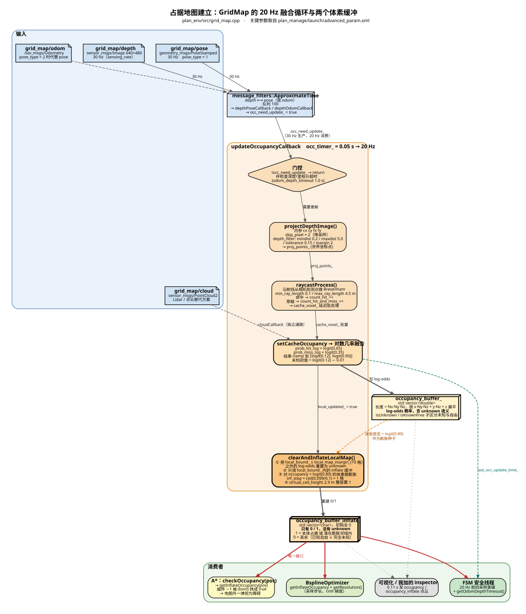

# EGO-Planner 整体流程图与数据流说明

> 目标：把「传感器 → 占据地图 → 规划 → 控制」这条链路上**每个环节的输入输出、topic、消息类型、
> 触发频率、关键工程参数、状态机转移条件**放在一起，作为读代码和调参的对照图。
> 所有数值与接口均取自本仓库源码与 launch 配置，行号可核对。

目录：

| 文件 | 内容 |
|---|---|
| `01_dataflow_overview.svg` / `.png` | 全链路数据流总览（传感器→建图→规划→控制） |
| `02_fsm_states.svg` / `.png` | **状态机**：7 个状态 / 转移条件 / 每状态调用的函数与接口 |
| `03_replan_pipeline.svg` / `.png` | 单次重规划 `reboundReplan` 的 STEP1/2/3 与 A\* 的确切位置 |
| `04_mapping_loop.svg` / `.png` | 建图 20 Hz 融合循环与两个体素缓冲 |
| `index.html` | 上述 4 张图的内嵌单文件浏览器视图（双击即可看，无需依赖） |
| `*.dot` | Graphviz 源文件，可改完重新 `dot -Tsvg` |

重渲命令：

```bash
cd docs/architecture
for f in *.dot; do dot -Tsvg "$f" -o "${f%.dot}.svg"; dot -Tpng -Gdpi=160 "$f" -o "${f%.dot}.png"; done
```

---

## 一、全链路数据流（图 1）



Mermaid 版（便于在不支持 SVG 的 Markdown 查看器里阅读）：



**这条链路上三个容易看错的地方：**

1. **规划栈只读 `occupancy_buffer_inflate_`**（`char` 0/1，不含 unknown 语义），
   `occupancy_buffer_`（log-odds，含 unknown）只服务可视化；`isUnknown/isKnownFree`
   在整个规划包里零调用。
2. **未知区域 × 在 A\* 眼里等于自由**，所以"A* 能往没看过的地方搜"；
   但**地图边界外** `getInflateOccupancy` 返回 `-1`，`(bool)-1 == true`，一律视为障碍。
3. **全局轨迹不是被优化的对象**，它只是"目标点采样器"，见 03 图与下文。

---

## 二、状态机（图 2）





### 各状态的主要函数与接口

| 状态 | 主要函数 | 函数接口（真实签名） | 关键判据 |
|---|---|---|---|
| `INIT` | 无 | — | `have_odom_` |
| `WAIT_TARGET` | 无（纯守卫） | — | `have_target_ && have_trigger_`，否则 `goto force_return` |
| `SEQUENTIAL_START` | `planFromGlobalTraj(10)` → `callReboundReplan(true, rand)` → `publishSwarmTrajs(true)` | `bool reboundReplan(Vector3d start_pt, Vector3d start_vel, Vector3d start_acc, Vector3d end_pt, Vector3d end_vel, bool flag_polyInit, bool flag_randomPolyTraj)` | `drone_id ≤ 0 \|\| have_recv_pre_agent_` |
| `GEN_NEW_TRAJ` | `planFromGlobalTraj(10)` → `callReboundReplan(true, rand)` → `publishSwarmTrajs(false)` | 同上 | 起点取 `odom_pos_ / odom_vel_ / 0`（`ego_replan_fsm.cpp:620-622`） |
| `REPLAN_TRAJ` | `planFromCurrentTraj(1)` → `callReboundReplan(...)` 三级退让 | 同上 | 起点取 `local_data_` 三阶状态（`:649-651`） |
| `EXEC_TRAJ` | 不规划：`getLocalTarget()`、`planNextWaypoint()`、`changeFSMExecState()` | `void getLocalTarget()` / `void planNextWaypoint(const Vector3d next_wp)` | `t_cur = now − local_data_.start_time_`（`:549-551`） |
| `EMERGENCY_STOP` | `callEmergencyStop(odom_pos_)` → `EGOPlannerManager::EmergencyStop(stop_pos)` | `bool EmergencyStop(Eigen::Vector3d stop_pos)` | `flag_escape_emergency_`、`\|odom_vel_\| < 0.1` |

`changeFSMExecState(new_state, pos_call)` 有一个副作用判据：
`new_state == exec_state_` 时 `continously_called_times_++`，而
`timesOfConsecutiveStateCalls().first > 1` 会打开 `flag_randomPolyTraj`——
**这就是"连续失败 → 随机化逃逸"的实现方式**。

---

## 三、一次重规划内部发生了什么（图 3）



关键点：

* `ts = control_points_distance / max_vel × 1.5 = 0.4 / 2.0 × 1.5 = 0.3 s`，即控制点间距 ≈ 0.6 m。
* **STEP 1 有两条分支**：首次 / 强制走多项式最小化轨迹（A）；重规划常态走"续接上一条 B 样条"（B）。
* **A\* 只出现在 `initControlPoints()` 里，且只对"被标记为碰撞"的 segment 调用**；
  它的产出**只有** `base_point[] / direction[]`（推挤基点与方向），
  **真正让轨迹绕开障碍的是 STEP 2 的 L-BFGS 梯度下降**。
* `check_collision_and_rebound()` 会在 `calcDistanceCostRebound()` 里被反复调用，
  每次发现新障碍都会**再跑一遍 `initControlPoints`（即再调 A\*）**。
  实测一次运行中 `a_star_list` 十几秒就涌出数万条 marker，量级由此可见。
* **STEP 3 只在 `pp_.drone_id ≤ 0` 执行**；多机模式直接跳过并打印 `IN SWARM MODE, REFINE DISABLED!`。

---

## 四、建图循环（图 4）



`updateOccupancyCallback()`（20 Hz）的三段式：

```cpp
projectDepthImage();                                   // 深度图 → 世界坐标点云
raycastProcess();                                      // 沿射线做 log-odds 融合
if (md_.local_updated_) clearAndInflateLocalMap();     // 重建 0/1 膨胀图
```

两个缓冲的语义差异是整张图的核心：

| 缓冲 | 类型 | 取值 | 是否含 unknown | 谁读 |
|---|---|---|---|---|
| `occupancy_buffer_` | `std::vector<double>` | log-odds 概率，clamp 到 `[logit(0.12), logit(0.90)]`，未知初值 `logit(0.12)−0.01` | ✅（靠 `clamp_min_log_ − 1e-3` 判据） | 可视化、膨胀种子 |
| `occupancy_buffer_inflate_` | `std::vector<char>` | 只有 `0` / `1` | ❌ **0 同时代表"已知自由"和"完全未知"** | **A\*、BsplineOptimizer、FSM 安全线程** |

`clearAndInflateLocalMap()` 的两个窗口**不一样**，这点很容易看漏：

* 把 log-odds 重置为 unknown 的范围是 `local_bound_ ± local_map_margin(10 格=1 m) ± vec_margin(5)` 的外壳环带；
* 而 inflate 缓冲**只在 `local_bound_` 之内**被清零并重建。

所以**局部窗口外的膨胀值是被"锁存"的**：见过的障碍离开视野后仍以 `1` 长期驻留。

---

## 五、odom 到底带了什么（`nav_msgs/Odometry`）

发布者：`poscmd_2_odom`（仿真里 odom 由位置指令直接积分；真机上是 VIO/LIO）。
订阅者：`EGOReplanFSM::odometryCallback()`（`plan_manage/src/ego_replan_fsm.cpp:225`）、`GridMap`。

| 字段 | 实际语义 | 在规划里被谁使用 |
|---|---|---|
| `header.frame_id` | `"world"` | 所有 marker / TF 的参考系 |
| `pose.pose.position.x/y/z` | 世界坐标位置 [m] | → `odom_pos_`；用于 **`planFromGlobalTraj` 的 `start_pt_`**、`waypointCallback` 的 `init_pt_`、`getLocalTarget`、`callEmergencyStop(odom_pos_)`、swarm 距离过滤 |
| `twist.twist.linear.x/y/z` | 线速度 [m/s] | → `odom_vel_`；用于 **`planFromGlobalTraj` 的 `start_vel_`**、`EMERGENCY_STOP → GEN_NEW_TRAJ` 的 `‖odom_vel_‖ < 0.1` 判据 |
| `pose.pose.orientation.w/x/y/z` | 姿态四元数（仿真里由 `acceleration + 9.8ẑ` 与 yaw 构造推力方向） | → `odom_orient_`；**FSM 里只存不用**（`start_yaw_` 相关代码已注释，`traj_server` 用前视点自己算 yaw） |
| `twist.twist.angular.x/y/z` | ⚠️ **被复用为线加速度**（`poscmd_2_odom.cpp:54-56` 把 `_cmd.acceleration` 塞进 angular） | 规划器**不读**；`odom_acc_ = estimateAcc(msg)` 已注释掉 |

> 结论：规划器从 odom 只取 **位置 + 线速度**（还有一份不用的姿态）。
> 重规划时**连这两项都不取**，而是用上一条 B 样条在 `t_cur` 处的解析三阶状态。

---

## 六、频率总表

| 环节 | 触发方式 | 周期 | 频率 |
|---|---|---|---|
| `pcl_render_node` 出深度/点云/相机位姿 | `sensing_rate` | 1/30 s | **30 Hz** |
| `poscmd_2_odom` 出 odom | **事件驱动**（每收到一条 `PositionCommand`） | — | **≈100 Hz** |
| `GridMap::updateOccupancyCallback` | `occ_timer_` | 0.05 s | **20 Hz** |
| `GridMap::visCallback` | `vis_timer_` | 0.11 s | ≈9 Hz |
| 深度 ⟷ 位姿同步 | `message_filters::ApproximateTime` | 生产 30 Hz，消费 20 Hz | — |
| `EGOReplanFSM::execFSMCallback` | `exec_timer_` | 0.01 s | **100 Hz** |
| `EGOReplanFSM::checkCollisionCallback` | `safety_timer_` | 0.05 s | **20 Hz** |
| 稳态重规划 | `t_cur > replan_thresh_` | 1.0 s | **1 Hz** |
| 事件重规划 | 安全线程 / 他机冲突 / 换航点 | — | 事件驱动，可达 20 Hz 量级 |
| 全局轨迹 `planGlobalTraj` | `planNextWaypoint()` | — | **每个目标 1 次** |
| A\* `AstarSearch` | `initControlPoints` / `check_collision_and_rebound` | — | 事件驱动，**一次重规划内数十次** |
| L-BFGS | 每次优化 | ≤200 iter | 每次重规划 1~多次（重启 ≤3） |
| `traj_server::cmdCallback` | `cmd_timer` | 0.01 s | **100 Hz** |

实测校验（`src/planner/ego_planner_inspector/docs/sample_run_analysis.txt`，68 s / 119 次重规划）：
周期重规划均值 **1.00 s**，与上表一致；另有 55 次 0.10 s 量级的密集重规划，
来自 20 Hz 安全线程发现新碰撞后的即时重规划。

---

## 七、建图关键工程参数（`plan_manage/launch/advanced_param.xml`）

| 参数 | 值 | 作用 / 备注 |
|---|---|---|
| `grid_map/resolution` | 0.1 m | 体素边长；同时也是 `resolution_inv_` |
| `grid_map/map_size_x/y/z` | 50 / 25 / 2.0 m | 地图尺寸；`map_origin = (−x/2, −y/2, ground_height)` |
| `grid_map/local_update_range_x/y/z` | 5.5 / 5.5 / 4.5 m | 局部更新窗口（≈感知范围） |
| `grid_map/obstacles_inflation` | 0.099 m | 膨胀半径；`inf_step = ceil(0.099/0.1) = 1` 格 |
| `grid_map/local_map_margin` | 10 格 = 1.0 m | 局部清理余量，决定"锁存"边界 |
| `grid_map/p_hit` / `p_miss` | 0.65 / 0.35 | 命中/未命中概率 → `prob_hit_log_` / `prob_miss_log_` |
| `grid_map/p_min` / `p_max` | 0.12 / 0.90 | log-odds 截断区间 `[−1.99, 2.20]` |
| `grid_map/p_occ` | 0.80 | 占据判据 `min_occupancy_log_ = logit(0.80) = 1.386` |
| `grid_map/min_ray_length` / `max_ray_length` | 0.1 / **4.5 m** | 射线投射范围 = 有效感知半径 |
| `grid_map/depth_filter_mindist/maxdist/tolerance/margin` | 0.2 / 5.0 / 0.15 / 2 | 深度图三明治滤波 |
| `grid_map/skip_pixel` | 2 | 深度图降采样（640×480 → 320×240） |
| `grid_map/k_depth_scaling_factor` | 1000 | 深度单位换算 |
| `grid_map/virtual_ceil_height` | 2.9 m | 该层整层 inflate = 1（限高） |
| `grid_map/ground_height` | −0.01 m | `map_origin.z` |
| `grid_map/visualization_truncate_height` | 1.8 m | 点云可视化截断高度 |
| `grid_map/pose_type` | 1 | `1=POSE_STAMPED`，`2=ODOMETRY` |
| `grid_map/odom_depth_timeout` | 1.0 s | 深度/里程计超时 → `flag_depth_odom_timeout_` |

> 注意 `max_ray_length = 4.5 m` 与 `fsm/planning_horizon = 7.5 m` 的关系：
> **规划视野刻意大于感知半径（≈1.5 倍）**，所以局部目标点在设计上就落在未观测区。
> 这是"A\* 把未知当自由"能成立的前提。

---

## 八、规划关键工程参数

| 参数 | 值 | 作用 |
|---|---|---|
| `manager/max_vel` | 2.0 m/s | 物理限速 |
| `manager/max_acc` | 6.0 m/s² | 物理限加速度 |
| `manager/max_jerk` | 4 | 物理限加加速度 |
| `manager/control_points_distance` | 0.4 m | → `ts = 0.4/2.0×1.5 = 0.3 s`，控制点间距 ≈0.6 m |
| `manager/feasibility_tolerance` | 0.05 | 允许 5% 的 vel/acc 超限，超出才做时间重分配 |
| `manager/planning_horizon` | 7.5 m | 用于判定初始路径"异常长" |
| `manager/use_distinctive_trajs` | true | 走 `distinctiveTrajs` 多分支优化 |
| `manager/drone_id` | 0 | `≤0` 才启用 STEP 3 REFINE |
| `fsm/thresh_replan_time` | 1.0 s | **稳态重规划节拍** |
| `fsm/thresh_no_replan_meter` | 1.0 m | 临近终点时抑制无意义重规划 |
| `fsm/planning_horizon` | 7.5 m | **滚动目标前推距离** |
| `fsm/emergency_time` | 1.0 s | 碰撞距今 < 1.0 s → EMERGENCY_STOP |
| `fsm/flight_type` | 2 | `1=手动 2D Nav Goal`，`2=预设航点` |
| `fsm/waypoint_num` | 4 | 预设航点个数（单机 demo 沿 x 轴来回） |
| `optimization/lambda_smooth` | 1.0 | 平滑项权重 |
| `optimization/lambda_collision` | 0.5 | 避障项权重 |
| `optimization/lambda_feasibility` | 0.1 | 可行性项权重 |
| `optimization/lambda_fitness` | 1.0 | 贴合参考项权重 |
| `optimization/dist0` | 0.5 m | 期望避障安全距离（`cps_.clearance`） |
| `optimization/swarm_clearance` | 0.5 m | 多机安全距离 |
| `bspline/limit_ratio` | 1.1 | 时间拉伸比例上限 |
| A\* `step_size` | **0.1 m（硬编码）** | `bspline_optimizer.cpp:520` 直接写死 |
| A\* 池尺寸 | **100³（硬编码）** | `planner_manager.cpp:40`，有效窗口 `center ± 5 m` |
| A\* 超时 | 0.2 s | `dyn_a_star.cpp:236`，超时即本次规划失败 |

---

## 九、读图顺序建议

1. 先看 **图 1** 建立"谁喂谁"的印象，重点盯红色边——规划栈对地图**只有一个接口**。
2. 再看 **图 2**，把 7 个状态和 5 类触发源（`FSM / SAFETY / TRIG / TRAJ_CHECK` + 定时器）对上。
3. 然后 **图 3**，理解"A\* 只提供方向、梯度优化才避障"，以及"全局轨迹从不更新"。
4. 最后 **图 4**，弄清 `char` 缓冲里为什么没有 unknown，以及 4.5 m 感知半径 vs 7.5 m 规划视野。
