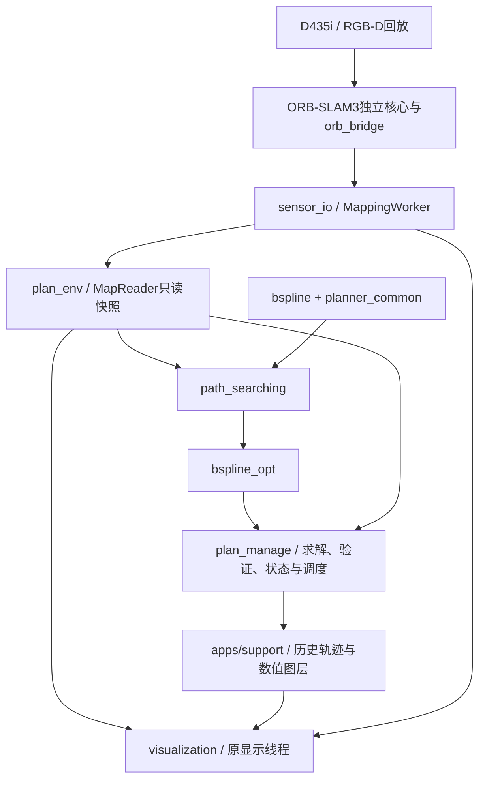

# EGO 占据建图与无 ROS 规划

本项目在 RK3576 上使用 D435i、ORB-SLAM3 和同进程占据地图，提供实时／回放建图、地图保存加载、离线 A* 与 B 样条规划，以及固定起终点的在线静态轨迹预览。控制器、移动起点连续规划和主动探索不在当前交付范围内。

工程位置：`/home/lckfb/orb-slam3/ego-occupancy-20261112`。用户入口统一位于父项目 `scripts/`，项目内部 `scripts/` 保存构建辅助与验收工具。

## 常用命令

```bash
cd /home/lckfb/orb-slam3

# 完整正式构建：桥接库 → ABI检查 → 独立ORB重链接 → 建图与规划
bash scripts/build_ego_occupancy.sh

# 仅离线规划，不需要RealSense、OpenCV或Pangolin
bash scripts/build_ego_planner.sh

# 实时占据建图；--check只做参数及输入预检
bash scripts/run_ego_occupancy.sh --check
bash scripts/run_ego_occupancy.sh --max-seconds 120

# 在线静态规划：停稳后P生成前方短段，C清除
bash scripts/run_ego_online_static.sh --max-seconds 120

# 使用已有RGB-D记录回放；输出目录必须是新目录
bash scripts/run_ego_occupancy.sh --dataset /绝对路径/记录目录/rgbd \
  --camera /绝对路径/记录目录/camera.yaml --output /绝对路径/新的输出目录

# 离线规划与成组验收
bash scripts/run_ego_plan_snapshot.sh --help
bash scripts/run_ego_planner_validation.sh
```

`build_ego_online_static.sh` 是完整构建加 CTest 的兼容入口。完整构建和在线预览共用 `build/release/bin/ego-rgbd-map`；普通建图不传规划参数时不启用在线规划。

## 实时相机后端

`ego-rgbd-map --live` 默认使用 RealSense。使用 Orbbec SDK v1.10.37 时，构建选项为
`-DEGO_BUILD_ORB=ON -DEGO_BUILD_ORBBEC=ON -DEGO_BUILD_REALSENSE=OFF`，
并通过 `-DOrbbecSDK_ROOT=/path/to/OrbbecSDK_v1.10.37/SDK` 指向包含 `include/` 和 `lib/` 的 SDK 目录。
在 RK3576 上使用对应的 ARM64 SDK。两个实时后端可以同时启用。仅回放时可关闭两者，应用仍可用 `--dataset`。

```bash
build/release/bin/ego-rgbd-map --live --camera-backend orbbec \
  --vocabulary /path/to/ORBvoc.txt \
  --camera config/cameras/SV1301S_U3_RGBD_640x480_60fps_rectified.yaml \
  --map-config config/ego-occupancy.yaml --output /path/to/new-output-dir \
  --lock-root /path/to/existing-lock-dir --no-viewer
```

SV1301S_U3 的运行配置选择 640×480@60 的彩色流和 640×400@60 的原始深度流。
v1 管线做软件 D2C，后端将彩色图校正到同一无畸变网格，再核对 640×480 输出内参及深度比例。
`Orbbec.DepthWidth/DepthHeight` 指定的是对齐前尺寸。优先选 `Y16`，`Y11` 等原始格式需由 SDK 解包，
应用只接收对齐后可按 `uint16` 读取的深度。
`RGBD.DepthMapFactor = 1000 / getValueScale()`，以最终对齐帧的毫米/原始单位为准。

SV1301S_U3 的两路设备时钟不可直接比较，且不支持 SDK FrameSync。
后端使用 SDK 报告的主机接收时间，只接收时差不超过 10 ms 的新帧对。
接收时间不能证明曝光同步，实际时差和配对率需要上板检查。
连接多台 Orbbec 时使用 `--serial`。 `--check` 只做配置预检，不打开设备。

实时录制会在 `rgbd/` 下备份输入标定。Orbbec 沿用 `--camera` 指定文件的文件名，
RealSense 保存为 `rgbd/D435i.yaml`。运行目录根部另有通用备份 `camera.yaml`。
[原始 PinHole 标定](config/cameras/SV1301S_U3_RGBD_640x480_60fps.yaml)保留工厂畸变参数，
上面命令使用单独的 [Rectified 运行配置](config/cameras/SV1301S_U3_RGBD_640x480_60fps_rectified.yaml)。

## 模块与查找索引

各模块使用 `CMakeLists.txt`、`include/`、`src/`。公共引用方式仍为 `<ego_occupancy/...>`、`<ego_planner/...>`，桥接头文件仍为 `pose_bridge.h`。

| 目录 | 主要职责／文件 |
|---|---|
| `src/plan_env` | `map`：概率占据、Free/Occupied/Unknown、只读快照；`io`：地图保存加载 |
| `src/sensor_io` | `depth`、`worker`、`current_frame`、`live_source`：深度输入、建图线程、RGB画面和实时采集 |
| `src/orb_bridge` | `pose_bridge`：独立ORB核心与应用间的位姿／来源接口 |
| `src/bspline` | `bspline`、`polynomial_traj`：轨迹数学 |
| `src/planner_common` | `planning_types`、`planning_request`、`planning_config`、`seed_builder` |
| `src/path_searching` | `planning_map_view`：机体外廓查询；`astar`：碰撞段路径搜索 |
| `src/bspline_opt` | `collision_constraints`、`rebound_optimizer`：约束构造和优化 |
| `src/plan_manage` | `planner_core`、`trajectory_validator`、`planning_fsm`、`planning_runtime` |
| `src/visualization` | `display`、`display_color`、`planning_layer`：地图／RGB／轨迹显示 |
| `apps` | 五个用户程序入口；`support`负责应用选项、规划结果IO与在线装配 |
| `config` | 占据配置、规划配置；`tasks`内为人工任务示例，不代表真实场景坐标 |
| `tests` | 按模块归类的正式回归；`support`内为公共夹具；`integration`为CLI和在线装配验收 |
| `third_party/lbfgs` | LBFGS实现及来源许可 |
| `core` | 独立ORB库、补丁源码／对象、原始依据与新链接记录，不能作为普通缓存删除 |
| `scripts/build` | 桥接构建、ABI检查、重链接及必要辅助函数 |
| `scripts/validation` | 离线成组验收、报告绘图 |
| `docs` | 设计、开发问题、验收证据和历史记录 |

## 数据流与模块依赖



只有建图端写概率地图；A*、优化及同轮验证共享一个只读快照。求解后释放旧快照，在最新地图上复核，显示接收数值图层。目录调整不改变该共享机制、严格Free策略、机体外廓或地图时效判据。

## 构建目录与测试

| 目录 | 用途 |
|---|---|
| `build/release/bin`、`build/release/lib` | 完整正式程序及库，独立ORB核心依赖这里的桥接库 |
| `build/planner/bin`、`build/planner/lib` | 无相机／显示的离线规划构建 |
| `build/checks` | 临时UBSan及功能开关验证，验收后可删除 |

```bash
cd /home/lckfb/orb-slam3/ego-occupancy-20261112
ctest --test-dir build/planner --output-on-failure

# 必须在可访问的实际桌面中执行；认证沿用当前登录会话
EGO_TEST_DESKTOP=1 DISPLAY=:0 ctest --test-dir build/release --output-on-failure
```

桌面测试返回跳过时不能算作桌面验收通过。完整功能保留原36项CTest名称；桥接路径契约另包含7项Python单元测试。

不删除原始 `../ORB_SLAM3/build` 或 `core/obj`：当前独立核心的重链接依赖这些已验证对象。`core/build-manifest.json`、`relocation-input.json`为历史原文，`layout-migration.json`记录本次路径映射，`relocation-manifest.json`记录实际新链接。

## 配置、输出与当前限制

- `config/ego-occupancy.yaml`：地图范围、分辨率、概率和新鲜度参数。
- `config/planning.yaml`：实验机体外廓、速度／加速度和资源限额；不代表已测量无人机参数。
- `config/tasks/example_gate.yaml`：合成地图中的示例，不直接用于实机。
- 运行时打印 `DATA_DIR` 和 `RUN_DIR`；数据与轨迹保存在父项目 `data`，运行和构建日志保存在父项目 `logs`。
- 在线任务冻结起终点，地图变化触发复核，确认碰撞后重算；输入失效会撤销任务。没有控制器执行闭环或主动探索。
- RGB-D局部地图沿初始相机光学坐标轴，不可直接把Z解释为重力高度。

开发与验收见 [目录迁移记录](docs/layout-migration-2026-11-16.md)、[在线静态实验](docs/online-static-experiment-2026-11-16.md)。历史文档中的旧路径保留为开发记录，当前路径以本README与迁移清单为准。
