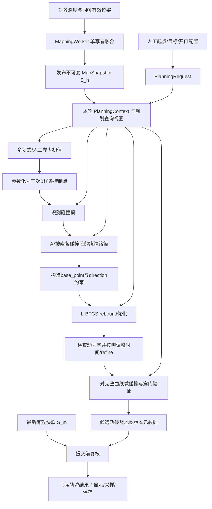
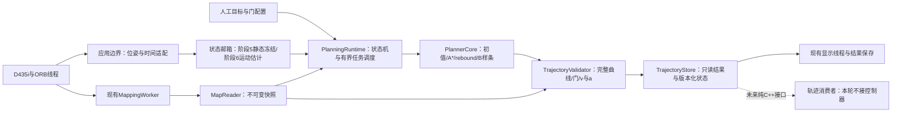

# RK3576 无 ROS EGO 规划移植方案（设计稿）

> 状态更新（2026-11-15）：独立A*与基础数学库已于2026-11-14交付；优化器、完整曲线验收与纯事件FSM的P1–P3已完成板端部署，见[验收与开发记录](../../optimizer-integration-2026-11-15.md)。P4在线worker/实时图层和P5/P6手持连续重规划仍待接入，细化路线见[补充计划](2026-11-15-ego-optimizer-online-replanning-design.md)。

最初设计日期：2026-11-13。本文基于实际源码检查和需求确认，给出整体架构、拟定文件组织、阶段对应与验收；以下为总体约定，实际开发状态以上方更新及后续验收记录为准。

## 1. 已确认的目标与边界

目标是沿用 RK3576 + D435i + ORB-SLAM3 + 已完成的占据地图，在同一个 C++ 进程内加入 EGO 规划。近期验收是：人工指定开口与前后参考点，使用触发时冻结的静止实验起点，在离线及手持地图上生成、检查、显示和保存穿过指定开口的轨迹。

用户已确认：

- 先静止起点验证，速度与加速度设为零，再做连续重规划。
- 保留 EGO 原有“初始轨迹 → 碰撞段 A* → rebound B 样条优化”链路。
- A* 先作为独立模块验证，再接入优化器。
- 首轮人工指定开口及前后参考点。
- 无人机含桨叶外廓和开口尺寸暂未确定，先进行手持实验。

第一轮交付包含下面阶段0～5，包含小型规划状态机。阶段6是上机前可做的手持连续重规划，不纳入第一轮完成条件；阶段7仅列出未来机体适配和飞行验收条件。控制器、飞控通信、起降、实际飞行、自动洞口识别、探索未知空间、动态障碍预测、多机和大范围滚动地图均不在第一轮范围内。

保留原建图、录制、离线回放和显示入口。规划核心不依赖 ROS、catkin、消息生成、PCL、相机 SDK 或 Pangolin；交互、图像与显示是应用边界。使用 C++17、Eigen 和当前源码实际使用的 L-BFGS 实现。

## 2. 源码检查结论

上游检出版本：`bfda51284c8c1b476043255a8145ef925a3778a5`。`planner_manager.cpp` 有用户新增的中文注释，当前差异仅为注释，本次只读，不覆盖。

| 模块 | 真实职责 | 移植处理 |
| --- | --- | --- |
| `plan_manage/planner_manager.cpp` | 生成多项式参考/初值，参数化 B 样条，调用约束构造和优化，必要时重新分配时间 | 保留算法顺序；外部注入地图、配置、状态、目标和时钟，移除内部创建第二个 GridMap |
| `bspline_opt/bspline_optimizer.cpp` | 检查碰撞段，调用 A*，由路径构造 `base_point/direction`，执行 rebound/refine 优化 | 绑定本轮只读规划视图，统一失败返回和全局预算 |
| `path_searching/dyn_a_star.cpp` | 26邻域搜索；通过 GridMap 查询膨胀占据 | 复用地图索引和分辨率，改为有界工作区与规范 C++ 容器，补边界/边连接检查 |
| `bspline_opt/uniform_bspline.cpp` | B 样条参数化、De Boor 求值、导数、可行性检查、时间伸长 | 先独立提取为数学库，明确控制点矩阵实际为3×N |
| `traj_utils/polynomial_traj.cpp` | 多项式初值/参考轨迹 | 保留数学能力，不引入整个可视化模块 |
| `plan_manage/ego_replan_fsm.cpp` | ROS 里程计/目标输入、定时重规划、碰撞回调与轨迹发布 | 不整份搬运；首轮实现等待/规划/复核/失效的小型非ROS状态机，后续扩展运动触发；飞行执行与制动另作设计 |
| `plan_manage/traj_server.cpp` | 接收样条，按时间求位置/速度/加速度及偏航，发布 PositionCommand | 首轮只提供纯 C++ 轨迹求值接口与文件输出；不移植命令发布端 |

重要事实：

1. `planGlobalTraj()` 生成的是多项式参考，不是经过地图搜索的无碰撞全局路径。
2. 原生 EGO 不是每次都从起点到终点运行一次完整 A*。初始轨迹参数化成控制点后，优化器对碰撞段调用 A*，将绕障路径转成局部碰撞约束；优化过程中还可能再次触发 A*。
3. Manager、A*、优化器原本持有同一 `GridMap`。我们保留“同一地图输入”的原则，改成“同一轮查询同一不可变快照”。
4. 多处上游碰撞检查只覆盖前约2/3轨迹，不能直接用于首轮整条静态穿越轨迹的交付判断。
5. 上游速度/加速度可行性检查按坐标分量进行；读取了 `max_jerk` 不代表完整链路已严格限制 jerk。新交付需明确三维速度/加速度上限，单独报告 jerk，不能把代价项等同于硬约束。
6. 上游 A* 步长0.1m、100³节点池等设置不适合直接照搬到当前5cm体素和小开口场景。还需审查无穷大常量、开放队列分数更新、旧搜索结果、端点调整、索引和路径交点求解等边界行为，不把去ROS等同于纯文本替换。原随机初值用起终点方向与世界Z轴叉乘，恰好沿当前光学Z方向穿越时可能退化；移植应选择稳定的正交扰动基并固定随机种子。
7. 优化器实际主要需要占据查询和分辨率；此次链路不要求新增 ESDF。

## 3. 两条路线及选择

- **已选：保留原生 EGO 主链路。** 先验证独立 A* 和数学库，再移植 rebound/refine。与原实现容易对照，避免同时改变搜索、初值和优化策略。
- **未选：每轮完整 A* → 路径重采样 → B 样条。** 容易观察全程搜索结果，但会改变 manager 的初始化与暖启动方式。本轮仅把完整 A* 用作模块验证/诊断，不悄悄加入生产规划主链；后续若实验暴露原始初值明显不适合开口，再单独决策。

## 4. 建图、A* 与 B 样条的数据流



其中：

- A* 输出折线路径，不直接作为飞行轨迹，也不直接替代整条 B 样条的控制点。
- 碰撞约束由 A* 路径及原控制点的空间关系构造，供优化器使用。
- “没有碰撞段，因此不需要A*”与“A*搜索失败、没有得到约束”必须使用不同结果状态，不能都按空路径继续优化。
- B 样条输出包含阶数、3×N控制点、节点向量、时间区间以及位置/速度/加速度求值能力。
- 时间调整后的曲线再次验证，不能因为调整前通过就直接交付。
- 建图发布新快照不是“每一帧必定重跑 A*”；是否需要新规划由管理层和轨迹有效性决定。

## 5. 地图共享与并发机制

### 5.1 复用现有能力

现有 `OccupancyMapper` 由建图线程独占写入。融合、分类、膨胀完成后发布完整 `MapSnapshot`，其中包含 raw三态、膨胀标记和来源元数据。`MapReader::acquire()` 只返回当前有效且新鲜的快照；`latestForDisplay()` 允许查看失效历史，不用于在线规划入口。

规划不再订阅一份深度、不维护第二套概率地图、不从显示点云重建体素。A* 节点数组是搜索工作区，不是第二份建图数据。

### 5.2 一轮规划固定一个版本

规划任务开始时，获取一份 `shared_ptr<const MapSnapshot>`，建立只读 `PlanningMapView`。该任务的初值检查、A*、约束构造、B样条优化和首次完整验证全部使用它。算法查询期间不重新获取“当前地图”，也不在每次查询时加地图写锁。

快照版本键至少包含：`SourceStamp(session,map,revision)`、`epoch`、`sequence`。位置/目标还包含坐标系和来源。阶段5触发时检查当前位姿有效且新鲜，然后冻结实验起点p及v=a=0，生成独立frozen_state_id；后续相机采集帧号变化不修改这份实验状态。地图可以比状态晚/早几个输入帧，但必须同一坐标来源、同一有效epoch并满足各自时效，不能混用坐标重置前后的数据。

`EgoGridMapAdapter` 已有的 `getResolution()/getInflateOccupancy()` 可作为兼容入口；需要把规划净空、Unknown与端点语义收敛到统一视图，A*与优化器不能各自定义一套阻挡规则。

### 5.3 三槽快照的生命周期

当前最多三个后备槽。规划只长时间持有一轮所需的一份快照；A*和优化器共享该视图，不各自保存历史快照。轨迹结果仅保存版本键和自身曲线数据，不永久引用地图。

本轮在S_n上完成计算后，复制候选曲线与必要元数据，退出算法上下文，释放各模块对S_n的引用，再获取最新S_m做提交复核，避免单个规划任务同时钉住两份地图。显示也在提取自有点数组后尽快释放快照。

槽位耗尽时沿用现有“跳过发布并计数”的行为；规划不得阻塞建图或触发无限快照分配。验收检查发布跳过次数和地图年龄，不能只看算法耗时。

### 5.4 更新、失效和提交

| 事件 | 对正在计算的任务/结果的处理 |
| --- | --- |
| 同epoch普通新融合（sequence增加） | 允许当前任务完成；候选在最新稳定快照上复核，避免每次地图更新都取消导致饥饿 |
| 新地图、重置、回环等使来源/epoch失效 | 立即撤销轨迹可用状态，向 A*/优化器发取消信号，拒收旧结果；人工开口/目标也不能跨epoch沿用 |
| 地图或状态过期/跟踪无效 | 在线结果转为不可用或待验证，不使用历史快照伪装当前有效 |
| 新目标、人工重新触发或任务配置变化 | 任务队列只留最新请求，旧请求通过request_id/goal_version被取消或拒收 |
| 连续模式的普通新位姿 | 更新最新状态邮箱，合并为至多一个待处理请求；不因每个采集帧到来就取消求解，提交时检查状态偏差与时间 |
| 提交时S_m与S_n来源不兼容 | 丢弃候选，等待有效地图与新任务 |
| 最新S_m上发现碰撞/未知/越界 | 不交付为成功；低频重新规划或返回明确失败状态 |

提交时至少检查：最新地图有效与新鲜、状态与目标版本仍一致、请求总时限未超、冻结实验状态ID仍属于当前请求、完整曲线在S_m上满足碰撞与穿门条件。阶段5不因当前相机平移而比较新旧采集帧号、丢弃静态实验结果；连续阶段才增加实测状态时效/偏差与执行起点一致性检查。轨迹记录 `planned_on` 和 `validated_on` 两个版本键。

S_m复核后仍可能出现新观测；结果不能被称为永久安全。初版在线显示在新地图到来后标记待复核，复核完成再标为有效。手持连续模式仍检查整条当前预览曲线，因为没有控制器确认的执行进度；真实执行阶段才可按明确的执行时基检查剩余轨迹。轨迹可用性判定必须同时核对其validated_on与当前地图来源、epoch和sequence；普通新sequence到来但尚未复核时返回PendingValidation，而不是永久保存一个Ready布尔值。发布时再次做短版本检查，不能把已落后的复核结果标为当前有效；可以在预算内重试最新版本，否则保留待验证状态。重置后旧结果不能恢复为有效。

### 5.5 时间与预算

统一使用单调时钟测量耗时、任务截止和本机状态年龄；静态实验状态仅在触发时校验新鲜度，冻结后不再冒充实时状态，其后续年龄不作为当前相机状态年龄使用；传感器时间戳保留作配对/回放，不直接与单调时钟相减。离线文件模式明确标为 `OfflineValidation`，使用固定地图做几何验证，不改写历史时间戳把它伪装成新鲜在线地图。

手持初版采用人工/低频按需触发。建议以200ms总任务预算起测（实验配置，不是已测性能保证）；A*各段、优化重试及复核共享总预算，实时还受地图/状态年龄余量限制。节点数、曲线细分次数、重试和工作区均有上限；超预算返回 `Timeout/Unverified`。不允许把每段0.2秒、多个搜索和20次重试直接累加成无限制任务。

## 6. 规划语义：不能只把原接口接上

### 6.1 Unknown 与机体净空

原有三态与默认Unknown阻挡策略保留。在线规划不进入 Unknown/Outside，不把无深度或遮挡当作free，也不为提高成功率放宽未知策略。

现有膨胀只从Occupied生成。若仅查询“中心点Free且不在Occupied膨胀层”，机体外廓仍可能伸进Unknown。因此引入**只读规划碰撞视图**：以本轮快照的raw状态为依据，在局部ROI构造与实验外廓对应的配置空间掩码，只有外廓覆盖区域全部已知Free才允许轨迹中心通过。

首轮建议使用轴对齐实验盒，半尺寸先设 `[0.10,0.10,0.10] m`，由配置可改。这只是手持算法测试参数，不代表无人机尺寸。该派生掩码同时处理Occupied、Unknown和Outside，不再叠加一遍现有膨胀半径，避免双重膨胀。raw/inflated层继续供原建图显示和诊断使用。

派生掩码绑定快照版本、ROI与几何配置，只缓存有限范围，不做传感器融合或形成第二套概率地图；提供与其他层同坐标的O(1)阻挡查询，预算内生成，超预算拒绝本轮。ROI外查询阻挡，不能钳制到边界。

起点附近和开口两侧必须先观察为已知Free。若初始相机后方/机体周围未观测导致起点不满足净空，提示先扫描；不能自动清空起点周边。目标未知时返回等待观测，不以“搜索失败”掩盖输入不充分。

### 6.2 人工穿越门

首轮以配置文件提供同一地图坐标系中的起点、洞前点、洞后点及人工穿越门。门由平面中心、单位法向、平面内两个正交轴及一个内接矩形窗口描述。对圆形或不规则开口，人工选保守的内接矩形即可，无需本轮自动分割任意轮廓。

窗口初值/参考点只用于引导，不能保证最终优化曲线经过开口。因此完整曲线验收额外检查：从指定前侧到后侧穿越门平面，交点位于按实验外廓收缩后的有效窗口内，顺序与方向正确。无法证明满足则返回 `GateNotSatisfied`，从外侧绕到目标不算成功。

人工窗口与三维碰撞视图共同起作用：窗口位置正确不代表周围未知区域可通行；地图有绕行路线也不代表完成穿越任务。手持时可根据地图/相机坐标人工记录这些点；首轮不建设复杂的三维鼠标选点工具。没有可用实物窗口时先用已知尺寸合成场景验证。

### 6.3 完整曲线检查与动力学

A*邻接边必须检查经过的体素，拒绝对角穿角、薄壁跳过和ROI越界；起终点不能沿用上游无提示移动到其他格的行为。离散路径成功不等于平滑曲线成功。

对完整三次B样条逐段做保守碰撞验证：利用样条段的凸包性质及必要的细分，把保守包围区域与规划视图比对；区域完全Free才接受该段，否则继续细分或判不安全/无法验证。不得仅查控制点、少量固定采样点或前2/3；细分上限耗尽也不能当通过。时间重参数化后重新验证。

实验速度/加速度上限先采用可配置的三维范数语义；可利用导数控制点凸包给出保守上界，区别于上游逐坐标分量约束。首轮可用0.3m/s、0.5m/s²作数学实验默认值，静止起终点v=a=0，不作为飞行参数。jerk记录到诊断中，首轮不声称推力、倾角、机体姿态或真实制动距离已满足。

## 7. 整体架构、数据契约和内部文件组织

### 7.1 同一进程内的模块关系

沿用现有建图工程，新增 `planning/` 模块；不新建第二个SLAM/地图工程，不复制整个ROS `plan_manage`。算法核心是同步函数式接口，由运行时负责何时调用。线程、交互和设备类型不进入数学/优化接口。



| 层/模块 | 职责及边界 | 首次落地 |
| --- | --- | --- |
| 现有采集、ORB与MappingWorker | 同帧位姿/深度融合，维护唯一概率地图并发布快照；新增规划不改变其所有权 | 已有 |
| 应用边界适配 | 将已验证ORB位姿转成不含图像的数值状态；读配置、文件IO、显示数据转换 | 阶段4离线IO，阶段5在线位姿 |
| `PlanningMapView` | 绑定一个快照和实验外廓，提供统一索引/阻挡/边连接查询 | 阶段0 |
| 样条数学、A*、ReboundOptimizer | 分别负责曲线表示、碰撞段绕障和控制点优化；不自行启动线程或获取另一份地图 | 阶段1～3 |
| `PlannerCore` | 按原生EGO顺序组织一次同步求解，接受明确请求/视图/预算，返回候选或结构化失败 | 阶段4 |
| `TrajectoryValidator` | 完整曲线、净空、门与v/a验证；可独立用于新地图复核旧结果 | 阶段4 |
| `PlanningFsm` | 纯事件状态转换与动作决策，不做耗时搜索，不访问GL | 阶段4 |
| `PlanningRuntime`及内部`TrajectoryStore` | 管理worker、最新请求、取消与复核优先级；发布不可变轨迹，读取时检查版本和时效 | 阶段5 |
| `StateEstimator` | 同一坐标epoch内从有界位姿历史估计运动状态及质量；不承担SLAM或控制器职责 | 阶段6 |

保留现有相机/SLAM、建图、录制、显示线程，首轮只新增一个串行规划worker，负责求解和复核。输入事件写入短锁保护的邮箱；队列有界，重复地图/状态事件合并。收到事件即撤销旧版本的Ready资格，不必等长求解结束才在界面失效。worker优先处理失效/取消，再处理当前结果复核和最新规划；耗时计算均在锁外。若复核不能跟上地图发布，应降低计算负载或保持Pending，不能略过验证而维持绿色有效显示。独立复核线程仅在性能数据证明需要时增加。

GL绘制仍由显示线程拥有。显示读取轨迹自己的不可变点数组和状态，不读优化器正在修改的控制点。轨迹存储区最多保留当前展示结果和正在提交的候选；失败候选只进入有界诊断/文件，不无限积累。结果对象不钉住地图快照。规划进行中是否还能使用旧结果，由版本化有效性判定决定，不能仅凭状态机处于PLANNING或READY推断。

### 7.2 核心数据契约

| 类型 | 关键内容 |
| --- | --- |
| `PlanningMode` | `OfflineSnapshot`、`LiveStatic`、`HandheldDynamicPreview`；明确区分静态实验和真实运动边界 |
| `PlanningState` | p/v/a、参考点、坐标来源、state_id、观测时间/可用时间及其时钟域、有效性/估计质量；静态模式显式标记Frozen |
| `PlanningTask` | goal_version、目标、人工门/前后参考点、坐标来源、实验外廓；连续阶段增加门前/门后任务进度 |
| `PlanningRequest` | request_id、模式、冻结状态ID或运动锚点、任务版本、参数和截止时间 |
| `PlanningContext` | 本轮不可变地图视图、快照版本、配置空间几何、取消信号、预算 |
| `CandidateTrajectory` | 三次样条控制点/knots、时长、边界状态、计划锚点时间、来源版本、A*诊断与优化统计 |
| `PlanningResult` | 成功/失败原因、planned_on/validated_on、模式、曲线与p/v/a求值接口；不含地图指针 |
| `TrajectoryStatus` | Ready/PendingValidation/Invalid及原因；与几何曲线对象分离，在线读取时检查当前版本/时效/任务 |

失败状态至少区分：无新鲜地图、状态/目标来源不匹配、起点不安全、目标未知、目标被占据、搜索无路、预算耗尽、优化失败、完整曲线验证失败、未穿过指定门、坐标失效。不得只返回一个bool而丢失诊断。

### 7.3 拟定目录与文件

下列是实施后的拟定布局，不表示文件已经创建。保留已整理项目的根目录启动入口约定；仅展示相关内容，`data`、ORB核心、Pangolin及现有工具继续保留。阶段号见第8节。

```text
/home/lckfb/orb-slam3/
├── scripts/
│   ├── run_ego_occupancy.sh             # 已有建图入口，保留
│   ├── build_ego_occupancy.sh           # 已有构建入口，增加可选规划参数 [5]
│   ├── run_planning_snapshot.sh        # 离线规划入口 [4]
│   └── run_ego_planning.sh             # 同进程规划入口 [5]，模式由参数指定
├── data/results/                       # 地图/任务/曲线/报告，按运行目录归档
├── logs/                               # 构建、运行与性能日志
└── ego-occupancy-20261112/
    ├── CMakeLists.txt                  # 增加EGO_BUILD_PLANNER，默认关闭 [0]
    ├── apps/
    │   ├── rgbd_map.cpp                # 已有应用；只接入适配和runtime [5]
    │   ├── planning_io.h/.cpp          # 任务配置与结果读写 [4]
    │   ├── plan_snapshot.cpp           # 固定.egovox离线规划程序 [4]
    │   └── planning_state_adapter.h/.cpp # ORB数值位姿/来源/时间转换 [5]
    ├── include/ego_occupancy/          # 已有地图/worker/显示契约，按需小改 [5]
    ├── src/                           # 已有建图与显示；显示增加规划图层 [5]
    ├── planning/
    │   ├── CMakeLists.txt              # 数学、核心、运行时分目标构建 [0]
    │   ├── include/ego_planner/
    │   │   ├── planning_types.h        # 状态、任务、请求、结果、版本、预算 [0]
    │   │   ├── planning_config.h       # 有类型参数及单位/边界 [0]
    │   │   ├── planning_map_view.h     # 快照与配置空间只读查询 [0]
    │   │   ├── bspline.h              # 三次样条、导数、时间操作 [1]
    │   │   ├── polynomial_traj.h      # 原生多项式参考 [1]
    │   │   ├── astar.h                # 有界搜索与诊断 [2]
    │   │   ├── rebound_optimizer.h    # 碰撞分段、约束与优化 [3]
    │   │   ├── trajectory_validator.h # 完整曲线/门/动力学验证 [4]
    │   │   ├── planner_core.h         # 单次同步规划接口 [4]
    │   │   ├── planning_fsm.h         # 事件与状态转换 [4，6扩展]
    │   │   ├── planning_runtime.h     # worker/调度/内部轨迹存储接口 [5]
    │   │   └── state_estimator.h      # 位姿历史→运动状态及质量 [6]
    │   ├── src/                       # 与上述非纯数据头文件对应的.cpp
    │   ├── third_party/
    │   │   ├── lbfgs.hpp              # 保留许可的现有优化器 [3]
    │   │   └── SOURCE.md              # 上游版本、来源及移植差异
    │   └── tests/
    │       ├── map_view_test.cpp       # [0]
    │       ├── spline_math_test.cpp    # [1]
    │       ├── astar_test.cpp          # [2]
    │       ├── optimizer_test.cpp      # [3]
    │       ├── trajectory_validator_test.cpp # [4]
    │       ├── planner_core_test.cpp   # [4]
    │       ├── planning_fsm_test.cpp   # [4，6扩展]
    │       ├── runtime_contract_test.cpp # [5]
    │       └── state_estimator_test.cpp # [6]
    ├── config/
    │   ├── planning.yaml              # 实验几何、v/a、预算和触发阈值 [0起]
    │   └── planning_tasks/example_gate.yaml # 人工门及前后参考点 [4]
    ├── tests/                         # 已有建图/显示回归，继续保留
    ├── docs/                          # 实施时放部署说明、配置说明与验收记录
    ├── scripts/                       # 已有内部辅助工具；不混放公共启动入口
    └── build/                         # 构建产物，不散落源码目录
```

文件名与类名在实施时可以小幅调整，但模块边界保持：配置解析/CSV/JSON不进入优化器，ORB/OpenCV类型不进入状态机，Pangolin不进入规划核心，算法不反向调用相机线程。首轮不提前创建阶段6的空文件或大框架。

### 7.4 构建依赖与阶段对应

| 拟定CMake目标 | 组成/依赖 | 对应阶段 |
| --- | --- | --- |
| `ego_planner_math` | B样条/多项式；Eigen与标准库 | 1 |
| `ego_planner_core` | map_view、A*、rebound、validator、planner_core；链接math及现有ego_occupancy，使用lbfgs头文件 | 0～4逐步加入 |
| `ego_planner_runtime` | fsm、runtime及阶段6的state_estimator；core、Threads，不依赖ROS/图像/设备 | 4的纯FSM，5的worker，6的运动估计 |
| `ego-plan-snapshot` | apps/plan_snapshot与planning_io；core，应用边界配置解析依赖 | 4 |
| 现有`ego-rgbd-map`的可选规划能力 | planning_state_adapter、runtime、planning_io、显示适配；原有相机/ORB依赖仍只在应用层 | 5，6扩展 |

`EGO_BUILD_PLANNER=OFF`保持原建图构建路径。开启后先验证无设备/无GL的数学与核心目标；离线目标不要求连接相机或启动ORB。在线仍是现有可执行程序内的同一张地图，不用IPC、ROS话题或文件轮询共享地图。

## 8. 分阶段实施及验收

| 阶段 | 工作 | 必须看到的结果 |
| --- | --- | --- |
| 0：数据/碰撞视图 | 固定源版本；定义请求/结果/时钟及状态机事件契约；对接快照和配置空间ROI；手工场景夹具 | 三态/Outside、外廓触及Unknown、边界、相机坐标及来源失效测试通过；原建图回归保持 |
| 1：样条数学 | 去ROS提取UniformBspline、PolynomialTraj与必要类型 | 独立构建无ROS；端点/导数、时间缩放、3×N布局、退化输入、三维v/a上界验证 |
| 2：独立A* | 使用同一规划视图搜索整段测试路径，输出折线 | 已知开口可通过、封闭/未知不可通过；5cm细边框、对角穿角、负坐标、非法端点、多次搜索和超时均有明确结果；内存受限 |
| 3：原生rebound链路 | 初值→控制点→碰撞分段A*→约束→L-BFGS→refine | 记录每次A*用途和路径、约束及控制点前后变化；无障碍时允许不调用A*；数值/失败/重试边界测试及小规模梯度校验通过 |
| 4：静态完整规划及FSM | 无ROS Manager组织模块，离线读map.egovox；完整曲线/穿门/动力学验收；以假时钟测试纯事件状态机 | 在指定合成开口得到可复核曲线；关闭洞口、加入Unknown、缩小窗口、超限等正确拒绝；等待/规划/失败/取消转换可复现；输出样条及采样p/v/a/报告 |
| 5：RK同进程静态部署 | runtime接地图reader与当前位姿，人工触发静止起点规划；同窗显示A*、样条、门、冻结起点和当前相机；接入FSM及地图更新复核/按需重规划 | 手持/回放可复现；相机继续移动不把冻结起点改成当前位置；同epoch更新后复核，碰撞时撤销并从冻结起点按需重算；重置/过期撤销旧结果；不阻塞建图；保留全部基线 |
| 6：手持连续重规划 | 合成/录制运动状态→轻量状态估计→运动触发→未来锚点一致性→暖启动；扩展门任务进度与FSM，不要求无人机 | 缓慢手持运动时从不断更新的实验相机状态产生轨迹；显示规划锚点/相机、p/v/a与有效性；遮挡/碰撞/跟踪丢失正确响应；延迟、限额和状态质量可量化；不声称控制跟踪成功 |
| 7：未来真实机体适配与飞行 | 机体尺寸/外参、重力坐标、可靠机体状态、轨迹消费者协议、跟踪/制动与飞行测试 | 另立范围、设计和验收；本方案不实现控制器，不以阶段6完成代替飞行成功 |

阶段0～4先在工作站合成/已有地图上快速验证，再用RK3576同样的输入做交叉验证；阶段5集中测真实板端并发。第一里程碑止于阶段5，第二里程碑是阶段6手持动态预览；两者均可在无人机安装前完成。每一阶段保留前一阶段可运行入口，失败不继续堆叠后续模块。

离线输出建议：`request.yaml`、`bspline.json`、`trajectory.csv`（时间/p/v/a）、`astar-paths`、`planning-report.json`，记录raw/配置空间参数、source/epoch/sequence、求解时间、节点数、重试、碰撞/穿门/动力学复核及最终失败原因。可视化只是诊断，报告中的验收结果才决定Ready状态。

## 9. 重规划与状态机设计

### 9.1 三种模式的起点语义

| 模式 | 起点怎么取 | 相机移动后的行为 |
| --- | --- | --- |
| 离线固定地图 | 显式给定p、v=a=0；地图时间语义为离线 | 与实时相机无关；用于数学/碰撞/穿门回归 |
| 在线静态实验，阶段5 | 触发时检查新鲜位姿，再冻结p、v=a=0及frozen_state_id | 相机继续更新地图；曲线仍从冻结起点出发。新地图可触发复核/从同一冻结起点重算；想换起点需重新触发 |
| 手持动态预览，阶段6 | 从真实观测的相机运动状态p/v/a，预测到明确的短期规划锚点 | 自动低频生成新的候选轨迹；起点随实际运动更新，不假设相机在跟随上一条轨迹 |

因此，“手持时能看到轨迹”在阶段5已经成立；“手持移动时轨迹从不断更新的相机运动状态出发”是阶段6的明确目标。移动中的相机不能始终伪装为v=a=0。静态模式仍可用于走到新位置后停稳、重新触发的实验。

### 9.2 哪些事件需要重算

**先判断是否仍有效，再决定是否重新求解。** 每次地图发布都重新跑优化既浪费算力，也容易因更新频繁而永远无法提交。

| 触发原因 | 阶段5 | 阶段6增量 |
| --- | --- | --- |
| 人工新任务/重新冻结起点 | 取消旧任务，提交最新请求 | 同样处理；新门/目标更新goal_version |
| 同epoch地图更新 | 立即PendingValidation；对整条当前曲线复核。通过则更新validated_on，不调用A*；不通过则Invalid并排队重算 | 同样处理，同时检查当前运动锚点是否仍适用 |
| 目标/门周围新观测使原不可规划任务变为可规划 | 有新证据后限频重试；输入仍不充分则等待 | 同样处理，不忙循环 |
| 相机位置/速度发生足够变化 | 不改变冻结状态 | 相对上次规划锚点达到可配置位置/速度阈值时触发；另有低频定时刷新，且合并重复请求 |
| 跟踪丢失、坐标来源变化、地图/状态过期 | 立即Invalid，取消旧任务；来源重置后人工门与目标作废 | 同样处理，清空运动估计历史，不继承旧速度或暖启动 |
| 超时/无路/优化失败 | 返回原因；只有新任务、新证据或有上限的退避重试才再算 | 同样处理；不因失败高频随机重启 |

动态预览建议先以最多2Hz的新求解频率起测，地图复核由新快照事件触发、合并并按预算执行；这些是待测配置，不承诺每帧15Hz输出新轨迹。记录端到端P50/P95/最大时延、Pending持续时间、状态预测误差、超时率、内存和建图发布跳过。即使重算来不及完成，也必须如实显示Invalid/Pending；这不是自动制动能力。

### 9.3 一次重规划的完整时序

1. Runtime读取同一来源的任务、状态和地图版本；形成不可变请求。静态模式用冻结状态；动态模式选择短期未来锚点时间，并预测该时刻p/v/a。等待队列里的请求在真正启动时重新检查时效。
2. 建立S_n的PlanningMapView，沿原生链路求解。候选与已显示结果分别存放，不覆盖旧曲线的控制点。旧曲线能否保持Ready独立检查；发现新地图/状态不适用即失效。
3. 多次A*、优化、时间调整和首次全曲线检查共享截止时间。正常新地图/位姿只更新邮箱，不反复中止正在进行的计算；新目标/重置可以取消。
4. 释放S_n后，在最新有效S_m上复核整条候选及门约束。检查goal_version、来源、地图新鲜度和请求有效性。动态模式还检查当前实测状态与候选所用锚点的预测偏差、状态质量和可用时间。
5. 动态候选若已经错过锚点时间，或实测位置/速度偏差超过阈值，则拒收并合并新的请求；不能只把起点改成当前时间而沿用旧边界。阈值和预测前视时间以录制回放实测确定，不预先声称零时延。
6. 短锁内核对版本并发布不可变结果；显示线程采样绘制并标注模式、曲线起点/锚点、相机当前位置、版本与原因。新地图到来仍进入持续复核。

在阶段6中，旧样条仅作为可选的形状/控制点暖启动；先核对坐标、任务和状态兼容性，重新施加本轮边界并验证。不能照搬原FSM的`planFromCurrentTraj()`，直接按墙钟从旧样条取p/v/a当作当前相机状态。手持人通常不会严格沿规划曲线运动。

未来真实执行时，只有轨迹消费者确认执行起点/时基，且实测跟踪误差满足条件，才可用旧曲线未来状态做衔接，验证剩余轨迹并处理切换连续性。该消费者协议、停止响应与制动属于阶段7另立设计。

### 9.4 状态机首轮就设计并实现

状态机不是只能在无人机上调试的部分。阶段0明确状态/事件契约，阶段4实现并以假时钟测试，阶段5连接真实地图和位姿，阶段6增加运动触发。首轮是**规划任务状态机**，其主要状态如下：

| 状态 | 进入条件/动作 | 后续去向 |
| --- | --- | --- |
| `WAIT_MAP` | 没有有效新鲜地图；撤销在线结果可用资格 | 地图恢复后检查状态与任务 |
| `WAIT_STATE` | 当前模式所需位姿/运动状态缺失或质量不够 | 状态满足后检查任务；静态冻结后不以相机移动作为失效原因 |
| `WAIT_TASK` | 没有同来源有效目标/门/起点请求 | 人工任务到达后REPLAN_PENDING |
| `REPLAN_PENDING` | 已有最新请求，等待限频/worker；重复请求合并 | 输入通过检查后PLANNING，否则回等待态 |
| `PLANNING` | 同步核心在一个S_n上生成候选 | 成功到VALIDATING；失败到FAILED；失效/新目标取消 |
| `VALIDATING` | 完整检查候选，或在新地图上复核已有曲线 | 通过到READY；碰撞/不兼容则撤销并重算或等待 |
| `READY` | 当前任务已有通过验证的结果；这是任务状态，读取仍要做版本/时效门控 | 新地图到VALIDATING，新任务/运动触发到REPLAN_PENDING |
| `FAILED` | 记录明确原因并等待有意义的新证据/限次重试 | 输入不足回等待态；可重试时REPLAN_PENDING |

状态转换函数输出“启动求解/取消/复核/清除结果”等动作，worker执行动作；状态机内不阻塞求解。所有事件包含来源与版本，迟到的旧完成事件不改变新任务状态。跟踪丢失/重置有高优先级；即便worker尚未观察到取消，轨迹读取门控也已拒绝旧结果。

初版没有`EXEC_TRAJ`、`TAKEOFF`、`LAND`或可执行的`EMERGENCY_STOP`。它输出“不可继续使用该轨迹”的状态，而不声称已经制动。上游EmergencyStop将控制点全部放在当前位置，不能当作非零速度下的真实停车/制动轨迹。

### 9.5 运动状态、时间与门任务进度

当前已打通的是ORB位姿与地图坐标，不是经过验证的无人机p/v/a状态。阶段6增加有界位姿历史和轻量平滑拟合，输出速度、加速度、残差/质量和延迟；避免直接二次差分放大噪声。先用带真值的合成运动与录制回放验证。状态估计不能满足质量/年龄上限时进入WAIT_STATE，不静默退回“运动中v=a=0”。

位姿传感器时间、主机接收时间与任务单调时钟分别记录。现有`received`是主机接收时间，不等同于相机曝光时刻；阶段6需验证传感器时钟到主机时钟的对应和延迟范围，并在状态质量中计入不确定性。若无法证明预测锚点状态合格，只能标为几何预览，不能报告为通过动态边界验收的结果。

连续任务还要记录“门前/门后/到达”的进度，避免手持已穿门后仍要求新曲线重新穿一次：

- 门前的新候选仍须从指定侧经过有效窗口；优化初值沿前后参考点引导。
- 用连续、有效的实测相机状态判断是否正向穿过有效窗口；设置平面侧别滞回，防止边界噪声来回切换。预测轨迹或播放动画不能推进实际任务进度；从窗口外绕过不算穿门。预测锚点不得替代尚未观察到的穿门事件，必要时缩短前视或等待新状态。
- 确认穿门后，后续候选以洞后目标为终点，不再要求重新穿门。目标到达也依据实测状态和容差判定；阶段6仍是相机参考点与实验外廓的演示，不等于无人机机体已经安全穿越。
- 静态模式不维护模拟执行进度；它始终验证整条冻结起点到目标的曲线。来源重置时任务进度和手工坐标一并失效。

## 10. 手持、装机与飞行分别验收到什么

### 10.1 第一里程碑：阶段5静态手持验收

1. 先扫描起点周边、开口及两侧通道，使实验外廓覆盖区域已知Free；人工配置门和目标。存在Unknown时如实等待，不能自动挖空。
2. 停稳后触发，从冻结起点得到整条验证通过的样条；同窗能区分当前相机、冻结起点、门、A*诊断和最终曲线。报告给出p/v/a、地图版本和穿门/碰撞结论。
3. 继续移动相机完善地图，曲线保留冻结起点；地图更新后复核，发现碰撞则撤销并按需重算。走到新位置停稳、再次触发，应能得到新起点的结果。
4. 人为遮挡、放置静止障碍、关闭窗口，或在合成地图中构造Unknown/薄壁，验证拒绝与恢复；跟踪丢失、重置、超时必须看得到原因，不留下旧的有效颜色。旧地图中的障碍可能受概率融合影响而不会立刻消失，验收按实际地图证据判断。
5. 建图与RGB显示持续工作，规划内存/队列有上限，结果可保存和回放。不能只凭“画出一条线”验收。

### 10.2 第二里程碑：阶段6运动手持验收

**可以在手持移动时持续输出更新的规划轨迹。** 这里验证的是系统根据实际相机运动持续更新候选，而不是相机被控制器沿样条带着走。

先用合成状态和录制回放，再缓慢手持平移、转向、停下：轨迹起点/未来锚点随观测更新，边界p/v/a和估计质量可查；在已知Free范围内持续输出满足实验参数的曲线。手持超速、状态估计不可靠、地图过期或无法跟上计算时，允许并要求明确拒收，而不是硬输出成功。

观察新障碍后的失效与绕障重算、任务/目标改变、门前门后进度、跟踪失效及恢复。记录规划耗时分布、状态年龄、预测误差、地图复核延迟和Pending占比，确定RK端可承受的更新频率。当前状态到未来锚点的预测也需在其时间区间检查净空；候选起点在安全位置并不能掩盖预测接近过程中的碰撞风险。若此项无法验证，动态预览应标记Unverified。

无需把手持轨迹与规划曲线完全重合；可以显示二者偏差作为诊断，但不能据此评价无人机闭环控制。手持结果不包含执行确认、可实现制动或真实机体姿态下的净空保证。

### 10.3 哪些工作需要装机，哪些必须飞行

| 工作 | 离线/手持能完成 | 真实机体/飞行阶段增加的内容 |
| --- | --- | --- |
| 地图共享、A*、B样条、优化、完整曲线/门验证、规划FSM | 能；以合成和手持实验参数验收 | 换入真实参数再回归 |
| 连续重规划、失效/超时/取消、任务进度 | 能；用实测相机运动、回放和故障注入 | 检查执行时基、实测跟踪误差与切换条件 |
| 速度/加速度估计 | 可验证手持状态质量与计算链 | 真实机体参考点和状态源需另验，不默认相机估计足以飞行 |
| 含桨叶外廓、相机到机体外参、重力对齐 | 可先合成；真实参数需实物测量 | 装机后可先在地面标定，不必起飞才能做 |
| 飞控/控制器状态与轨迹接口 | 可用替身测试协议；本轮不实现 | 装机地面联调时钟、坐标、执行确认及拒收/失联行为 |
| 真实轨迹跟踪、推力/倾角/jerk、制动距离、振动/运动模糊与飞行定位稳定性 | 手持无法证明 | 需要受控飞行测试；先低速开阔区域，再单独评估穿越 |

当前地图是初始相机光学坐标、没有重力对齐；三维几何实验可用它，不能将“Z”直接当无人机高度。固定8×4×8m地图也不是滚动地图。阶段6仍限制在已知有效范围，不能通过放宽Unknown扩展成远距离导航。

## 11. 工程规范与验收边界

优先复用已确认数学和优化逻辑，不复制ROS胶水。配置为有类型的参数，单位和边界明确；取消/超时用单调时钟；不使用变长栈数组、百万次逐节点new、函数static跨任务状态或未初始化成员。用户对上游的注释保留；新增代码维持小类/清楚职责/RAII和可读命名，记录来源与必要许可证说明。

性能要分拆统计地图准备、ROI配置空间生成、A*、优化、重分配时间、完整曲线复核及提交复核；同时记录地图年龄、相机队列和快照发布跳过。不把工作站时延、单独算法时延或静止场景结果当作RK端完整实时保证。

尺寸未定时的0.1m实验盒与v/a默认只用于算法实验。首轮成功的定义是“在这份已知地图和显式试验参数下，产生经过指定门且验证通过的轨迹”，不包括定位真值、任意开口都成功、真实无人机动力学或穿洞飞行。

## 12. 源码定位

- [Manager初始化与共享地图](/home/jacobb/ego-planner/ego-planner/src/planner/plan_manage/src/planner_manager.cpp:14)
- [原生初始化/优化链路](/home/jacobb/ego-planner/ego-planner/src/planner/plan_manage/src/planner_manager.cpp:49)
- [碰撞段A*及约束构造](/home/jacobb/ego-planner/ego-planner/src/planner/bspline_opt/src/bspline_optimizer.cpp:37)
- [优化结束的前2/3检查](/home/jacobb/ego-planner/ego-planner/src/planner/bspline_opt/src/bspline_optimizer.cpp:916)
- [原生A*](/home/jacobb/ego-planner/ego-planner/src/planner/path_searching/src/dyn_a_star.cpp:138)
- [B样条可行性](/home/jacobb/ego-planner/ego-planner/src/planner/bspline_opt/src/uniform_bspline.cpp:136)
- [原生FSM碰撞回调](/home/jacobb/ego-planner/ego-planner/src/planner/plan_manage/src/ego_replan_fsm.cpp:377)
- [现有地图只读接口，本地板端源码镜像](/home/jacobb/deep_camera/logs/ego-depth-color-20261113/current/include/ego_occupancy/map.h:123)
- [现有地图发布与三槽生命周期](/home/jacobb/deep_camera/logs/ego-depth-color-20261113/current/src/map.cpp:561)
- [现有地图三态/膨胀语义](/home/jacobb/deep_camera/logs/ego-depth-color-20261113/current/src/map.cpp:395)


## 13. 设计检查与本次由我提出的默认选择

独立实施可行性检查提出一个重要歧义：手持阶段触发后，相机继续移动是否取消静态规划。根据用户已确认的“先静止起点”目标，本稿将它明确为触发时冻结的实验状态，与实时相机分开显示；以后连续阶段再采用实时状态一致性规则。这样既不因每帧位姿更新而饥饿，也不暗示旧起点轨迹从当前相机出发可执行。

0.1m实验盒半尺寸、0.3m/s与0.5m/s²数学上限、200ms任务预算、配置文件人工门、局部ROI派生碰撞掩码，均是本稿提出的可配置实现选择，用户并未提供真实飞行数值。本次补充的模块文件划分、首轮规划FSM、阶段6最多2Hz求解起测与未来锚点设计同样属于建议；不把阶段6提前并入阶段5交付。它们应随本稿审阅后固定到实施计划。此检查不是算法实测，本轮没有编译/运行规划器或修改上游程序。

补充稿已再做一次独立实施可行性检查，没有发现需要用户另行决策的重要缺口；章节编号、代码块和本地源码链接也已检查。上述检查仅针对设计完整性，不代表规划代码已经实现或性能验收通过。
