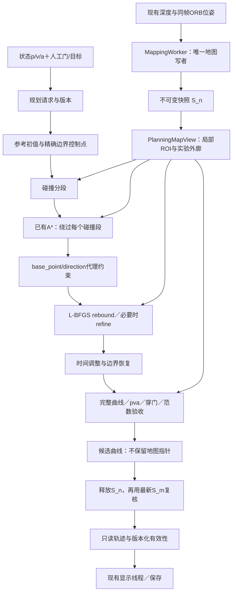

# EGO 优化器与在线重规划接入计划（补充设计稿）

> 后续实施（2026-11-16）：已接入P4在线静态自由空间探针，并完成板侧显示及轨迹数据实测。人工开口在线输入与P5/P6不在本轮验收内。见[在线静态实验记录](../../online-static-experiment-2026-11-16.md)。

> 实施状态（2026-11-15）：已交付P1–P3，Release与UBSan均17/17、原实际桌面14/14通过；P4尚未实施。见[开发与验收记录](../../optimizer-integration-2026-11-15.md)。以下保留总体设计与后续阶段边界。

日期：2026-11-15。本文补充[总体架构与移植方案](2026-11-13-ego-planner-port-design.md)，承接[独立 A* 与数学库验收](../../planner-foundations-2026-11-14.md)。本文初拟时只制定计划；实施结果以上方状态与验收记录为准。

## 1. 当前起点与交付边界

已验证代码以2026-11-14板端最终源码镜像为依据：`logs/planner-foundations-20261114/source-final/`。后续实施前先核对RK3576当前源码与该清单，保留板端后续修改，不能用旧镜像覆盖。

现有能力是 `PlanningMapView`、有界26邻域 `Astar::search()`、`Bspline`、单段 `PolynomialTraj::Quintic()` 和离线探针；不是已经有了完整轨迹规划器。Release 9/9、原桌面14/14、UBSan新增4/4是上一轮验收结果。ASan受板端39位虚拟地址空间环境限制，未通过启动，不能作为已有内存检查通过的证据。

沿用用户已经确认的选择：同一C++进程、原生EGO链路、先静止起点后连续重规划、人工开口和前后参考点、无人机尺寸未定先手持。控制器、实际执行/制动、自动洞口识别、动态障碍预测和飞行验收仍不纳入。

建议设三个交付节点，分别验收，不把它们作为一次不可拆分的大改：

1. **M1：离线完整轨迹。** 多项式初值、碰撞段A*、rebound/refine、完整样条/边界/穿门/动力学验证及报告。
2. **M2：在线静态实验。** 在现有建图进程接入小型规划FSM、人工触发冻结起点、地图更新复核及必要重算；显示真实相机与冻结起点。
3. **M3：手持动态预览。** 接可信运动状态、运动触发、候选切换与任务进度；移动相机时持续输出更新的轨迹。无人机装机不是此前置条件。

本稿中的限额/频率是起测建议，不是已经达到的实时指标；真实机体外廓、外参和动力学参数仍未确定。

## 2. 采用的链路与源码适配

已选路线继续是：多项式参考 → 初始三次B样条 → 对碰撞段调用A* → 构造base_point/direction → L-BFGS rebound → 按需时间调整/refine → 独立验收。完整A*探针保留作诊断，不作为每次生产规划必跑的全局前处理。

“完整A*折线→样条拟合”虽然能复用现有图示，但改变原EGO初始化和约束生成方式，本轮不改用这条路线。直接复制ROS FSM也不合适：原FSM可能从上一条预测轨迹取当前状态，而手持相机没有执行该轨迹。

### 2.1 先补齐参考轨迹和精确边界

- 无障碍/单段输入沿用现有五次初值；人工门任务用“起点→洞前参考点→洞后参考点→终点”的多段参考。参考可碰撞，由后续链路处理，不把它当作已通过验证的路径。
- 补多段五次参考及连接处p/v/a连续性。上游函数名为 `minSnapTraj`，但其Q矩阵使用三阶导数乘积，实际是jerk积分代价；按真实数学语义保留并注明，不误称已实现最小四阶snap。单段情况调用现有Quintic，避免照搬上游单段分支的边界处理问题。
- 使用分解求解和秩/有限值检查，避免复制反复显式求逆；限定段数和控制点数量。
- 现有 `Bspline::Parameterize()` 是最小二乘初值。增加独立边界处理，将均匀三次样条的首尾各3个控制点按要求p/v/a精确构造，优化只修改中间控制点；至少保留可优化自由度。
- 参数化、边界修正、优化及时间调整后都检查真实样条端点p/v/a残差。首尾固定段本身不安全时明确失败，不能通过移动起点/终点来修好它。
- M1～M3先只使用均匀、无重复内节点的三次样条，避免进入上一轮记录的特殊重复节点导数限制。

### 2.2 碰撞段A*与约束构造

新增 `CollisionConstraintBuilder`，将原 `initControlPoints()` / `check_collision_and_rebound()` 中的职责从优化器解开：

1. 对完整初值与相关控制多边形检查，定位需要处理的区间；区分控制点代理检查和最终曲线检查，修复原实现前2/3截断。
2. 选取同一视图内已验证的进入/退出点，调用现有A*，不启用上游自动挪动端点逻辑。
3. 从绕障路径与控制点关系构造有限、单位化的base_point/direction；保留约束来源和对应碰撞段。
4. 明确区分 `NoCollision`、`ConstraintsReady`、`SearchFailed`、`DegenerateConstraint`、`Timeout`、`Cancelled`。有碰撞却未生成约束，不能按空路径继续当作成功。

控制点间距接近零、路径长度为零、交点分母接近零、路径索引到边界、入口/出口缺失、固定边界段碰撞都必须有确定处理，不保留“忽略错误也许没关系”的分支。

验证报告需返回已证实碰撞的样条段、时间区间和相关控制点索引。若控制多边形检查未发现问题、完整曲线却碰撞，将该区间反馈给约束构造并在剩余预算内重启，不能因为“控制点都Free”而忽略曲线碰撞。Unverified与已证实碰撞分开记录，前者不能伪造碰撞见证。

碰撞依据统一是已有配置空间视图，包含Unknown与Outside。外廓已经计入，原 `dist0` 不再当作额外机体膨胀；若保留小的软净空偏好，作为可配置代价说明，不再新增硬膨胀层，也不照搬0.5m等上游默认值。本轮不建设ESDF。

### 2.3 ReboundOptimizer与L-BFGS边界

- 保留原平滑、碰撞代理、可行性代价及refine参考拟合职责；首尾固定控制点不进入优化变量。
- 第一版保留上游可行性软代价并记录其逐轴语义；最终三维速度/加速度范数是独立硬验收。软惩罚值小或逐轴合格，都不直接等于通过。
- 一次L-BFGS调用内固定代理约束；发现新碰撞时请求rebound重启，在外层更新约束，避免在线搜索过程中静默改变同一次求解的目标函数。该整理属于明确记录的移植差异。
- A*、约束生成、代价/梯度、线搜索、重启、refine和验证共用一个WorkBudget。先对实际lbfgs.hpp做取消契约测试；不能假设传一个progress回调就覆盖了所有迭代/线搜索分支。必要时做最小、可追溯的截止/取消补丁。
- 有限差分检查固定代理约束下的各项梯度，测试点避开分段代价拐点。检查NaN/Inf、全重复控制点、零梯度和线搜索失败；不使用VLA或每节点new。
- `Converged`、`AlreadyMinimized`、`MaxIterations`只描述数值求解状态。达到迭代上限的结果可以成为候选，但仍必须在预算内通过全部验收；Timeout/Cancelled不能提交Ready。

### 2.4 时间调整不能破坏运动边界

静止边界v=a=0时，全时间轴伸长可保持这些零边界；仍需重新验收。运动边界不为零时，现有 `scaledTime(r)` 会令v变为v/r、a变为a/r²，不能直接拿它充当保持当前运动状态的重规划。

M3若需要加时，应调整时长/节点间隔、重建要求的首尾边界控制点，再做refine/优化及完整验证。暖启动同样重新施加本轮边界。若初始实测状态本身超过实验限值，不通过改写其速度为零掩盖问题。

## 3. 独立验收器是输出的必经环节

新增 `TrajectoryValidator`，由PlannerCore及在线复核复用：

| 项目 | 要求 |
| --- | --- |
| 边界 | p/v/a满足请求容差；控制点、knots、时间、导数全部有限；无退化区间 |
| 整条碰撞 | 全部样条段，包含末1/3和固定边界段；Unknown/Outside/接触仍拒绝 |
| 验证方法 | 每段转为Bezier表示，利用凸包/AABB与必要的De Casteljau细分保守验证；包围范围全部Free才能接受，不能仅查离散点或控制点 |
| 无法证明 | 达到细分深度、体素访问或时间上限返回Unverified；不能按成功处理 |
| 三维动力学 | 使用现有导数控制点凸包范数上界；记录v/a上界，jerk作诊断，尚不声称推力/倾角/制动可实现 |
| 人工门 | 隔离门平面的根/交点，确认指定方向穿越，落入按实验盒收缩后的窗口；穿越顺序正确，不从外侧绕行；与地图碰撞检查同时满足 |

门约束先通过多段参考引导和最终硬验收落实，不把门中心点代价当作穿门证明。失败时返回 `GateNotSatisfied`，在预算内可试有限个明确参考初值，否则保留失败。切线接触、整段共面、多次反向穿越或根隔离无法判定时不接受。

对任意朝向的门平面，实验轴对齐盒在窗口轴u上的半宽为 `sum_i(abs(u_i)*h_i)`，窗口轴v同理；不能直接拿世界坐标某一分量收缩斜门窗口。窗口收缩后无有效区域即拒绝任务。

已有地图视图已按闭合外廓保守扩张。完整曲线验证以曲线中心包围区域查询该视图，不再叠加机体尺寸；人工门窗口收缩是独立的任务语义检查，不改变地图掩码。

## 4. ROI、地图共享和调度

### 4.1 每轮一个快照，局部ROI有界扩展

已有实测中，完整205万格准备加搜索约413ms，12789格局部ROI约1.43ms，均只是一次离线测量。因此本轮不默认每个规划请求派生整张地图。

ROI覆盖当前起点、目标、人工门参考、多项式/样条初值及搜索余量；为外廓和验证包围范围保留边界空间。先按约0.5m搜索余量起测，体素对齐、裁到地图边界，实际参数可配置，不能给不存在的观测区填Free。

一次求解尝试的ROI、几何与S_n固定，A*/优化/初检均共享同一视图。遇ROI越界或局部搜索失败，允许同S_n上最多一次有界扩大并重启尝试，释放旧视图工作区后再建新视图；所有尝试共享任务预算与体素上限，不退回无限全图搜索。报告明确搜索发生在ROI内，不能将ROI内NoPath宣称为整个场景绝对无路。

只缓存当前快照/相同ROI/相同外廓配置可复用的视图；缓存键必须包含完整来源、epoch、sequence与几何参数。第一版不做跨地图版本增量配置空间缓存，以免把失效管理复杂化。

### 4.2 快照与结果的生命周期

- Mapper继续单写者；不新增概率地图、不从显示点云反建地图。
- 一轮任务的所有模块借用同一视图。结果只保存曲线、诊断与版本，不长期保留快照。
- 当前三槽机制下，完成S_n上的求解后释放全部算法引用，再获取最新S_m做提交前验证。复核ROI重新覆盖候选曲线包围区域，不只覆盖A*节点。
- `planned_on`、`validated_on`保存SourceStamp(session,map,revision)、epoch和sequence。普通新sequence不取消正在进行的求解，但现有结果转PendingValidation；来源/epoch失效立即撤销结果并取消。
- 提交前及消费者读取时都核对任务、来源、地图时效和验证版本。复核后又出现新sequence，结果继续待复核，不能留下永久Ready布尔值。

### 4.3 线程与有界任务

首轮新增一个PlanningRuntime worker，串行执行规划和复核，尽量不再增加线程。采集/ORB、MappingWorker、显示各自保持现有职责。输入只写有界邮箱，优化、地图遍历和GL都不在状态锁内。

重复地图/状态事件合并；有效性读取门控不等worker完成才撤销。worker优先处理取消和待复核结果，新目标替换旧任务；普通位姿变化合并为一个最新待处理请求，避免15Hz取消导致永远算不完。记录事件到失效、事件到复核、Pending持续时间和地图发布跳过。

在线总预算先沿用200ms起测；M3新求解最多2Hz起测。复核随地图事件触发并合并，不承诺每帧输出新曲线。如果复核持续赶不上地图更新，应如实Pending并降低负载/调整ROI，而不是只降低显示更新频率来掩盖落后。

## 5. 在线状态机与三种重规划情形

### 5.1 FSM从M2开始接真实事件

在M1结束前完成纯事件状态机及假时钟测试；M2加入worker和真实输入。

`WAIT_MAP / WAIT_STATE / WAIT_TASK / REPLAN_PENDING / PLANNING / VALIDATING / READY / FAILED` 延续总体设计。FSM输出启动求解、取消、复核、撤销等动作，不执行耗时搜索；轨迹有效性与FSM状态分别维护。没有控制器确认的执行时基，不能加入假想EXEC_TRAJ进度或把Invalid称为已制动。

| 原因 | 响应 |
| --- | --- |
| 地图普通更新 | 先撤销当前版本Ready资格，复核现有曲线；仍安全只更新validated_on，不重跑A*；有碰撞/未知才请求重算 |
| 人工新任务/目标/门 | 增加goal_version、取消旧任务，只接收最新request_id结果 |
| 地图重置/回环来源变化/跟踪失效 | 立即Invalid、取消，清空暖启动与运动历史；人工目标/门不得跨epoch沿用 |
| 状态/地图过期或预算耗尽 | 明确等待/失败，不用历史快照伪装当前有效；不忙循环随机重试 |
| 普通位姿更新 | M2不改冻结起点；M3按位移/速度变化及低频定时条件合并触发 |

### 5.2 M2在线静态：地图变，实验起点不随手移动

人工触发时验证新鲜位姿，冻结p0、v=a=0与frozen_state_id。之后相机可以移动补图，曲线仍从冻结起点出发；有新碰撞时也从该冻结起点重算。要换起点需再次触发。

显示同时区分当前相机、冻结起点、人工门、参考初值、碰撞段A*和最终样条，并显示Ready/Pending/Invalid及原因。此时不会按墙钟自动让虚拟机体沿曲线执行。

### 5.3 M3手持动态：实际运动状态驱动候选

- 在应用边界从ORB桥接提取纯数值位姿，不把cv::Mat/SDK类型带入运行时核心。
- `StateEstimator`使用有界时间窗口和轻量拟合，输出p/v/a、参考点、观测/可用时间、坐标来源、残差与质量。先用带真值合成数据和回放验证；不能直接对噪声位姿二次差分。
- 保留传感器时间与主机received时间的区别，验证时钟对应和延迟；不能把主机接收时间直接宣称为曝光时刻。没有合格状态则WAIT_STATE，最多明确标为几何预览，不冒充动态验收成功。
- 每次候选针对明确的短期未来锚点p/v/a求解，当前状态到锚点的预测段也要验证。提交时检查是否错过锚点、状态预测偏差、任务与地图；不合格则拒收并合并新请求，不平移时间戳掩盖延迟。
- 旧曲线只作有条件的形状暖启动，不能按旧曲线墙钟位置假设人手正在跟随它。新的候选从本轮预测的实际状态出发，不要求无控制的人手运动能让所有相邻候选自动形成可执行拼接。
- 门前/门后/到达进度由连续有效实测状态推进，并有平面侧别滞回；预测曲线和动画不能推进进度。确认穿门后不再要求下一条曲线重复穿门，坐标重置则进度失效。
- 手持没有已确认执行进度，当前候选仍做整条曲线复核。未来真实执行的剩余轨迹、连续交接、跟踪误差、制动和轨迹消费者协议另立设计。

## 6. 文件增量与架构对应

根目录仍为 `/home/lckfb/orb-slam3/ego-occupancy-20261112`。不新建第二个规划工程或移动已验证模块；新增/修改按职责如下，名称为拟定接口：

| 路径/模块 | 职责 | 阶段 |
| --- | --- | --- |
| planning/include/ego_planner/planning_types.h | 保留WorkBudget/Roi，增加带来源/时间的请求、状态、任务、版本、候选与结构化失败 | P1 |
| planning_config.h；src/planning_config.cpp | 配置校验：几何、v/a、控制点/重启/ROI/验证预算与容差；解析留应用层 | P1 |
| polynomial_traj.h/.cpp；新seed_builder.h/.cpp | 多段五次参考、初值采样、精确边界控制点及暖启动边界恢复 | P1，P5扩展 |
| 新collision_constraints.h/.cpp | 碰撞分段、已有A*调用与代理约束，不藏在代价回调中 | P2 |
| 新rebound_optimizer.h/.cpp | L-BFGS代价/梯度、rebound/refine与求解诊断 | P2 |
| planning/third_party/lbfgs.hpp；SOURCE.md | 当前上游实现/许可证/必要取消补丁及来源记录 | P2 |
| 新trajectory_validator.h/.cpp | 完整曲线、边界、三维v/a及门约束，规划和在线复核共同使用 | P3 |
| 新planner_core.h/.cpp | 一轮同步规划、ROI/时间调整/有界重试与候选输出 | P3 |
| 新planning_fsm.h/.cpp | 纯事件状态转换；无SDK、GL或阻塞求解 | P3，P4接入 |
| 新planning_runtime.h/.cpp | worker、邮箱、取消/复核调度、内部TrajectoryStore与版本门控 | P4 |
| 新state_estimator.h/.cpp | 合格运动状态及质量；与SLAM、控制器解耦 | P5 |
| apps/plan_snapshot.cpp；planning_io.h/.cpp | 任务文件/离线入口及样条、诊断、采样和报告IO；保留现有astar_probe | P3 |
| apps/planning_state_adapter.h/.cpp；rgbd_map.cpp | 从现有桥接构建状态事件、装配runtime，不在应用文件堆优化算法 | P4 |
| 现有显示模块 | 读取不可变图层、状态与自有点数组，GL仍归显示线程 | P4、P6 |
| config/planning.yaml；planning_tasks/example_gate.yaml | 实验参数、手工门、前后参考点；不是飞行配置 | P1～P3 |
| planning/tests/ | 与上述模块对应的梯度、曲线、门、状态机、并发、回放与时序测试 | 各阶段 |

保留 `ego_planner_math` / `ego_planner_core`，core按需链接math；新增 `ego_planner_runtime` 仅依赖core和Threads。核心不引入ROS、PCL、OpenCV、ORB、相机SDK或Pangolin。在线仍通过已有 `ego-rgbd-map` 可选链接接入；规划总开关默认关闭。公共构建/运行入口继续统一在父项目 `/home/lckfb/orb-slam3/scripts/`。

## 7. 分步实施、阶段依赖和验收

| 阶段 | 对应总体阶段 | 实现与验证 | 用户应看到什么 |
| --- | --- | --- | --- |
| P1：输入、参考与边界 | 阶段3前置 | 有类型请求/配置、多段参考、精确端点p/v/a；静态和非零边界解析用例；零长度/非法参数明确拒绝 | 初值曲线和端点残差报告；当前A*入口全部保留 |
| P2：约束与优化器 | 阶段3 | 分段A*、代理约束、L-BFGS梯度/取消/重启、refine；无障碍无需A*、新增碰撞触发rebound；失败不混成空成功 | 同一图显示初值、碰撞段、绕障折线、优化前后控制点和样条；有分项代价/迭代/A*统计 |
| P3：完整离线规划与FSM | 阶段4，完成M1 | PlannerCore、完整验收器、时间调整、纯FSM；末1/3薄壁、未知、面/角接触、无门绕行、反向/切线穿门、动态超限/边界、预算细分耗尽等 | 优化曲线通过/拒绝有机器可读原因，整条曲线与p/v/a可回放；只画出平滑线不算通过 |
| P4：同进程在线静态 | 阶段5，完成M2 | MapReader＋当前位姿＋runtime/FSM＋显示；同epoch更新复核、失效取消、旧完成事件拒收、三槽生命周期、退出清理 | 停稳触发，冻结起点穿门样条；手持补图、地图变更后复核/必要重算，跟踪失效即时标记；RGB/地图持续工作 |
| P5：运动状态与动态回放 | 阶段6前半 | 带真值合成/录制状态、估计质量、未来锚点、错过时刻/偏差拒收、非零边界时间调整、任务进度与暖启动 | 无需相机也能复现运动重规划、延迟、丢帧、状态突变与坐标重置 |
| P6：RK手持连续预览 | 阶段6后半，完成M3 | 合格实测运动状态驱动低频连续候选；整曲线复核、ROI与时限、地图/状态过期处理 | 缓慢移动时轨迹从更新后的运动锚点出发；转向/停下/新障碍/穿门进度与失败原因可见；不是控制跟踪验收 |

建议下一次实际开发先交付P1～P3/M1，验收通过再进入P4，最后P5～P6。这沿用已确认的静态优先顺序，而不是把在线动态状态估计变成优化器移植的前置条件。

每一阶段：核对板端源码 → 先写行为测试 → 实现与-j1编译 → 本阶段及既有回归 → 保存命令/源码哈希/日志 → 再进入下一阶段。原ORB、建图、A*探针保持基线；板端优先UBSan与容器断言，ASan问题明确保留环境限制，可另外在支持环境测试，但不能替代RK部署验收。

## 8. 输出、性能与验收证据

M1输出 `request.yaml`、`reference.csv`、`collision-segments.json`、`astar-paths/`、`constraints.json`、`bspline.json`、`trajectory.csv(t,p,v,a)`、`validation.json`、`planning-report.json` 与初值/优化曲线对比图。诊断记录优化器状态与最终验证状态两个维度。

M2/M3增加 `events.jsonl`：状态机转换、request/goal/frozen_state ID、planned_on/validated_on、观测/可用/锚点时间、重规划原因、失效/复核/候选拒收原因及任务进度。记录单调时间与时钟域，支持确定性事件回放。

性能分拆ROI生成、碰撞检测、每次A*、约束、L-BFGS/线搜索、refine、完整验收、最新地图复核和提交；在线记录地图年龄、状态年龄、队列峰值、Pending时长、发布跳过、端到端P50/P95/最大值、取消响应和内存峰值。配置/硬件/数据不同必须分开报告。

最终成功标准分别是：M1在冻结地图和实验参数下生成经验证的整条穿门样条；M2在同进程活地图上维持真实可核对的有效性；M3在合格手持运动状态下持续更新候选。三者均不等于无人机已经具备实际穿洞飞行能力。

## 9. 设计检查与建议参数的归属

本稿经独立实施可行性检查，没有发现需要用户另行决策的重要缺口。已确认的路线与边界沿用既有选择；0.5m ROI起测余量、最多一次ROI扩大、均匀节点范围、200ms在线预算和最多2Hz动态新求解仍是建议配置，实施时需记录实际测量与调整原因，不作为已测保证。

初拟说明：当时只更新设计文件，未编译或部署；本日后续P1–P3实施结果见上方验收记录。后续实现继续展示关键文件创建、板端构建和测试命令。
